# GenAPI

`GenAPI` es una plataforma web que permite generar una base para `APIs REST` de forma visual mediante componentes `drag-and-drop`, facilitando la configuración de `rutas`, `endpoints`, `controladores` y `conexiones a bases de datos` sin tener que escribir manualmente toda la estructura inicial del código.

Está dirigida a `estudiantes`, `desarrolladores`, `docentes` y `personas interesadas en aprender o experimentar` con el desarrollo de APIs. Mediante la representación visual de sus componentes, busca favorecer la comprensión de la estructura de una API y facilitar la aplicación práctica de principios de diseño y buenas prácticas de desarrollo.

## Características

GenAPI ofrece las siguientes funcionalidades:

* Generación visual de APIs: permite construir la estructura de una API REST mediante componentes drag-and-drop.
* Configuración de rutas y endpoints: permite definir rutas, métodos HTTP, parámetros, controladores y respuestas.
* Validación de configuraciones: identifica configuraciones duplicadas, como nombres o rutas repetidas y combinaciones de método HTTP y ruta.
* Generación automática de código básico: crea los archivos necesarios para estructurar la API, incluidos controladores, rutas y archivos de configuración.
* Documentación automática: genera un archivo README con instrucciones para preparar el entorno y utilizar la API generada.
* Integración con bases de datos: permite configurar opcionalmente conexiones con los motores de bases de datos compatibles.
* Descarga del proyecto generado: permite obtener el código de la API en un archivo comprimido para su posterior uso.
* Interfaz de configuración: permite establecer información general de la API, como su nombre, puerto y descripción.

## Acceso a la plataforma

[GenAPI](https://bryan967132.github.io/gen-api/) está disponible como una aplicación web desplegada en GitHub Pages. No es necesario instalar software adicional.

## Interfaz

### Pantalla Principal
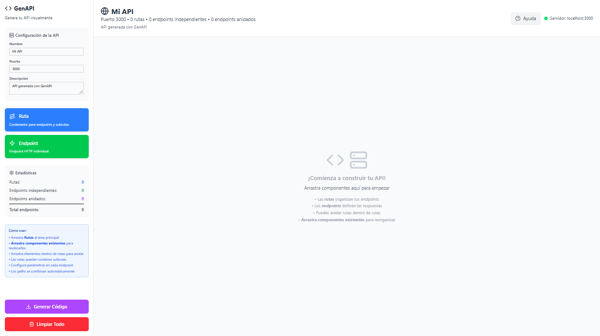

### Configuracion Basica
* Nombre de la API
* Puerto
* Descripción

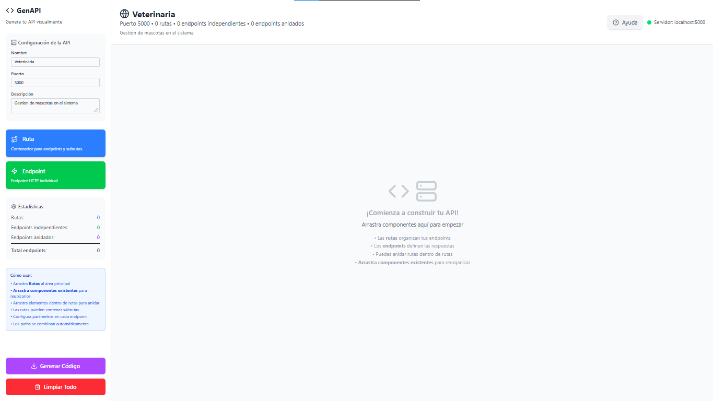

### Configuración de Ruta
* Ruta base del grupo
* Nombre del grupo

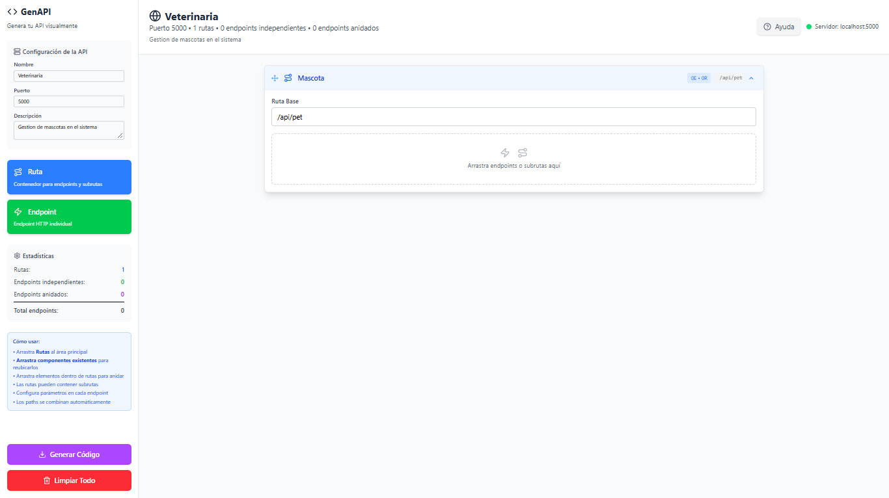

### Configuración de Endpoint
* Ruta del endpoint
* Tipo de parámetros
    * Sin parámetros
    * Route params
    * Query params
    * Body
    * Headers
* Parámetros enviados (si aplica)
* Respuesta exitosa
* Respuesta de error

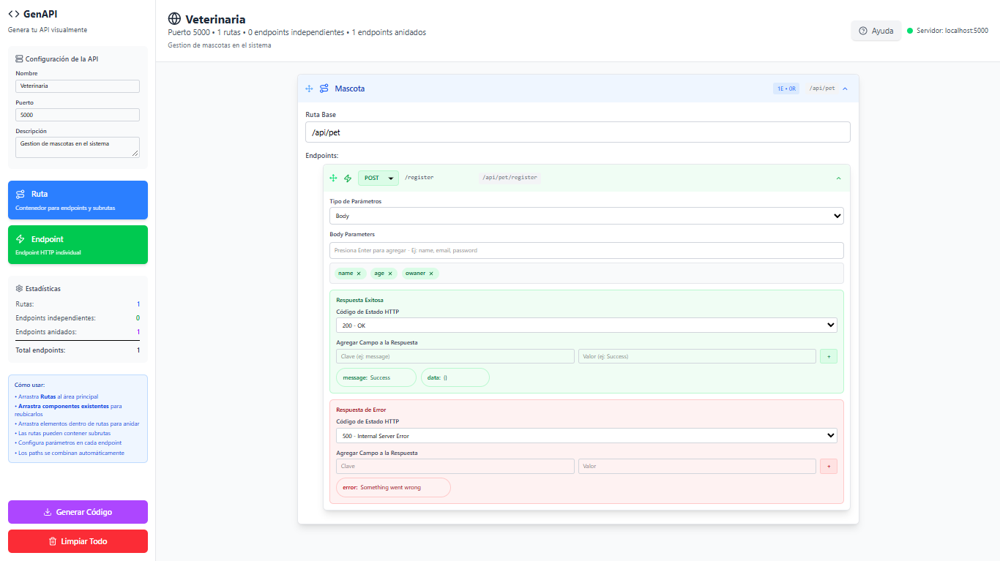

### Ayuda
* Bienvenida

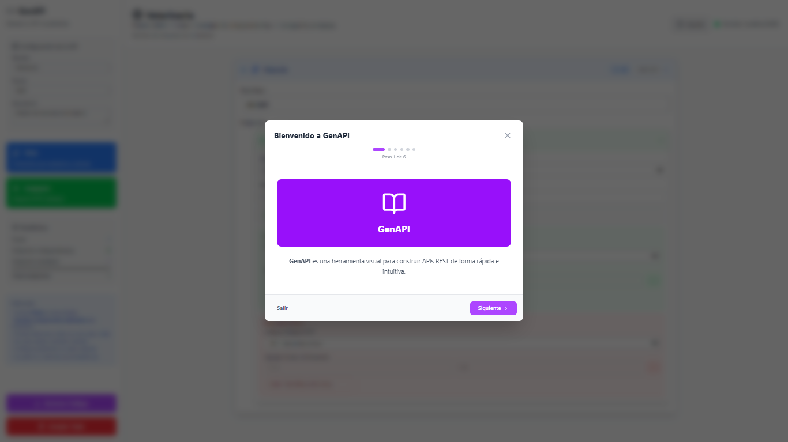

* Configuracion Inicial

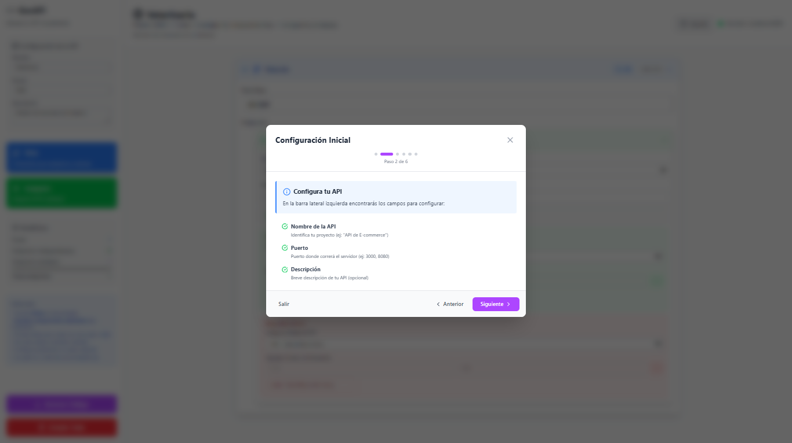

* Componentes

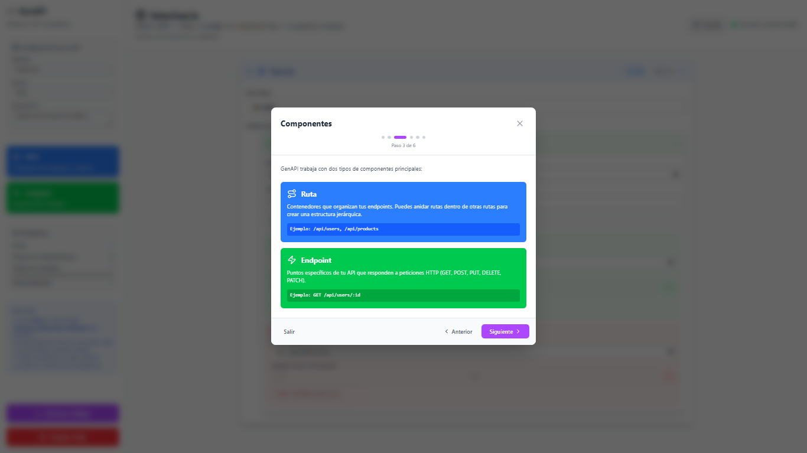

* Arrastrar y Soltar

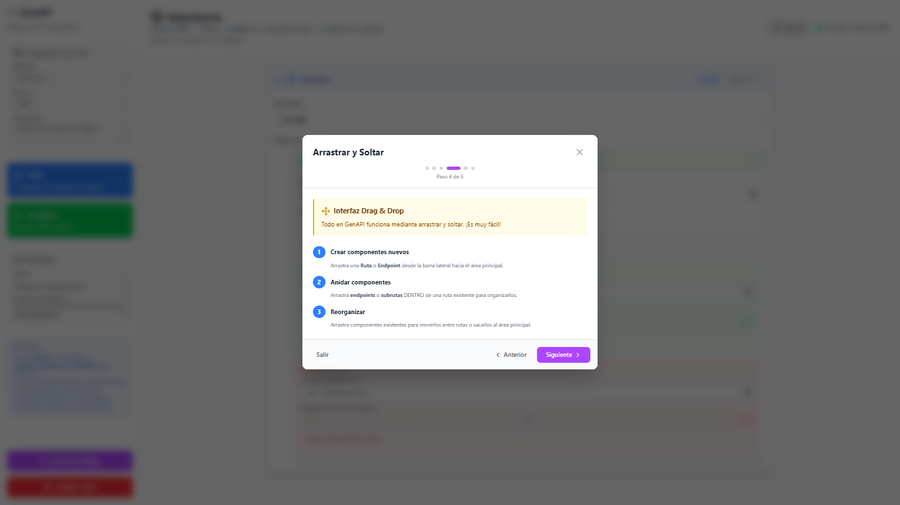

* Configurar Endpoints

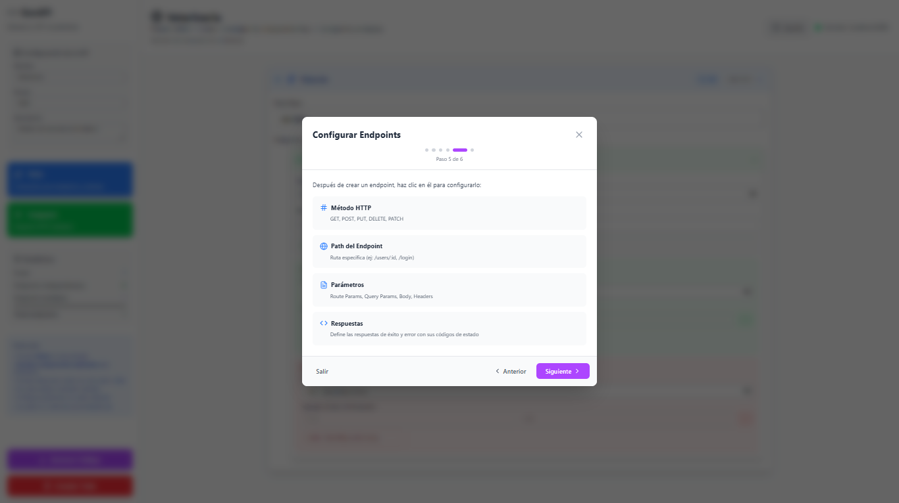

* Generar API

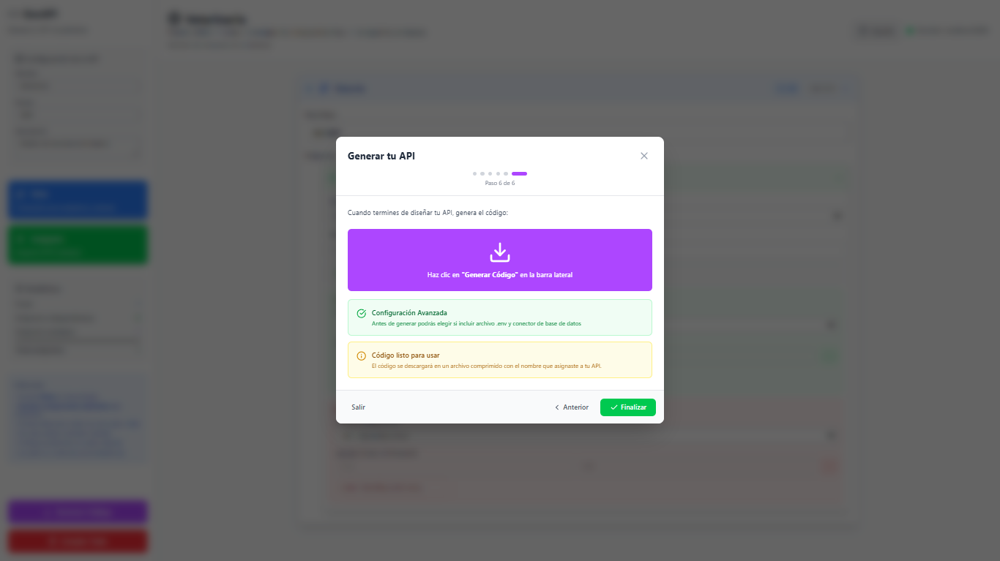

### Configuración Avanzada
* Configuracion del Proyecto
    * Uso de variables de entorno
    * Uso de conector a base de datos
        * Seleccion de motor de base de datos

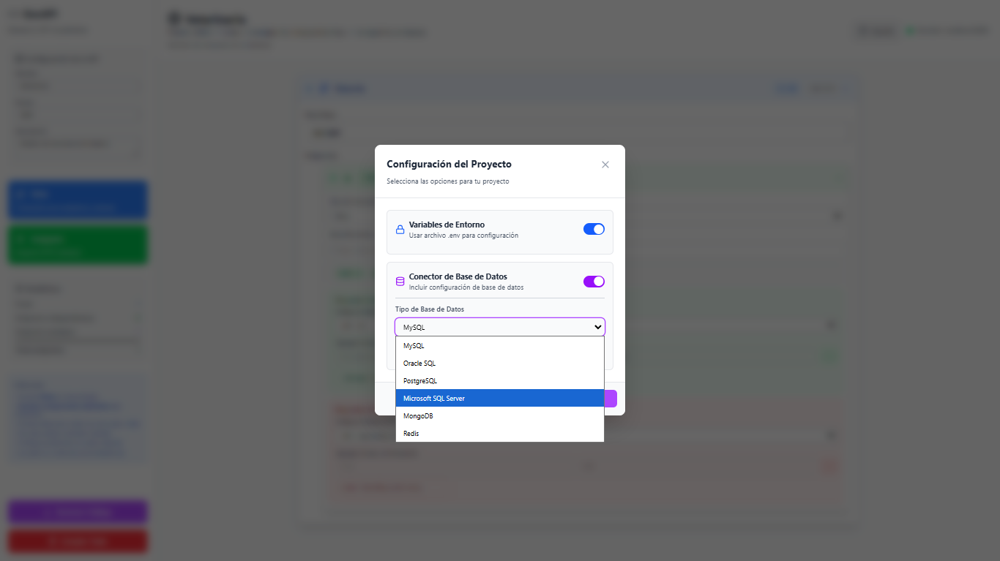

* Configuracion Establecida

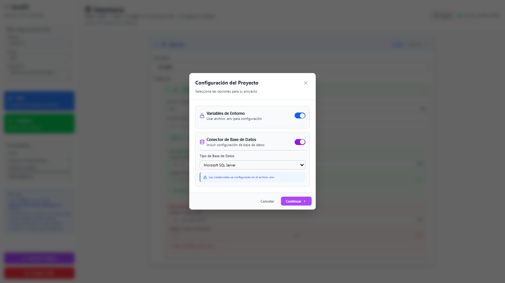

* Descarga de Código de la API

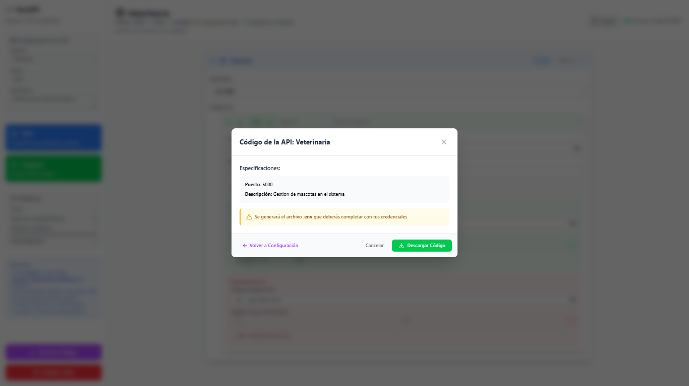

* Código Generado

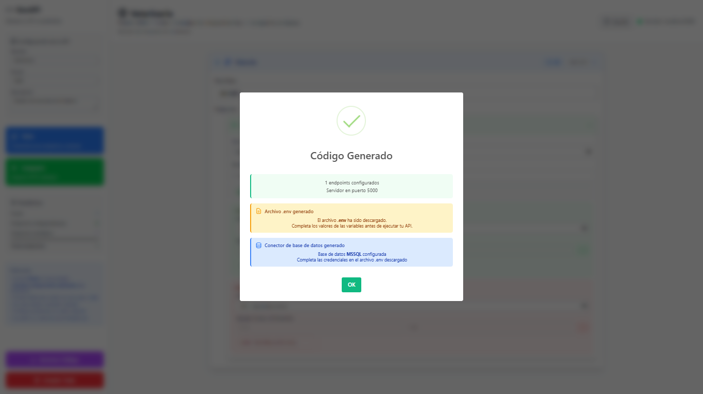

### Eliminar Todo
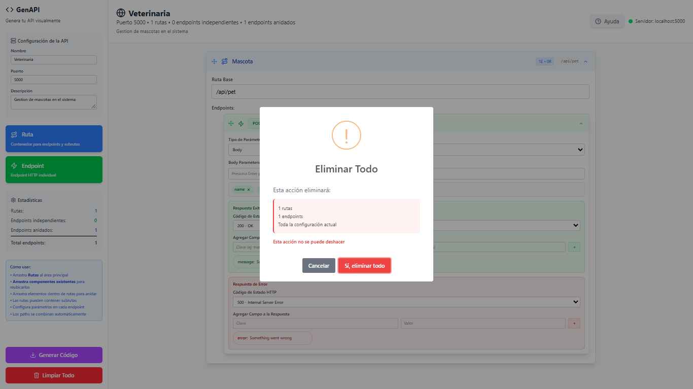

### Proyecto Generado
* Estructura del Proyecto

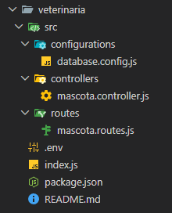

* Archivo de Configuración de Base de Datos

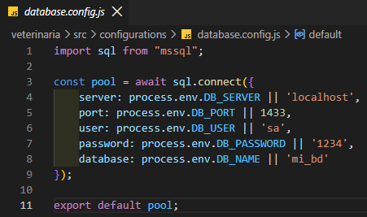

* Archivo de Controladores

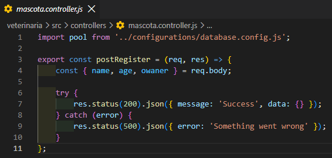

* Archivo de Rutas

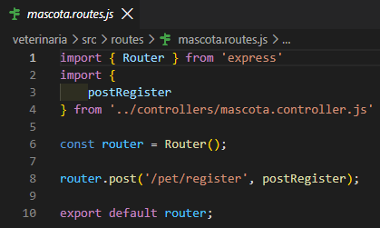

* Archivo de Variables de Entorno

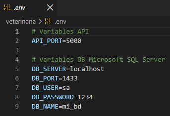

* Archivo Index

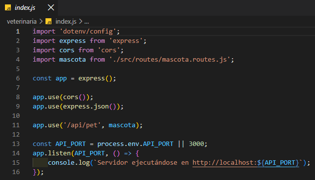

* Archivo de Dependencias

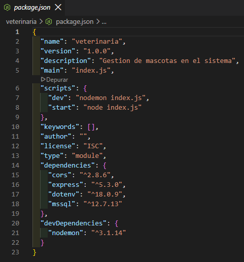

* Archivo README

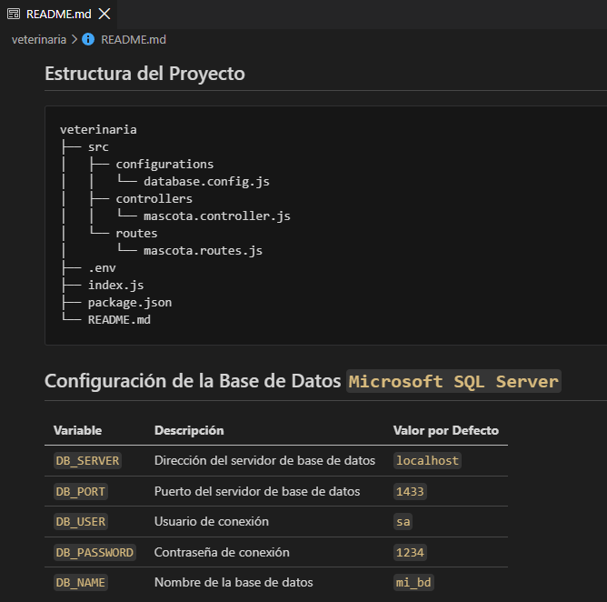

## Tecnologías Utilizadas

### Entorno y Herramientas de Construcción

| Tecnología | Versión | Propósito |
|---|---|---|
| Node.js | 22.14.0 | Entorno de ejecución de JavaScript |
| Vite | 7.0.4 | Servidor de desarrollo y empaquetador (bundler) |
| @vitejs/plugin-react | 4.6.0 | Integración de React con Vite (Fast Refresh, transformación JSX) |

### Frontend

| Tecnología | Versión | Propósito |
|---|---|---|
| React | 19.1.0 | Biblioteca para construir la interfaz basada en componentes |
| React DOM | 19.1.0 | Renderizado de componentes React en el navegador |
| Tailwind CSS | 4.1.11 | Framework de estilos basado en clases utilitarias |
| @tailwindcss/vite | 4.1.11 | Plugin oficial para integrar Tailwind CSS con Vite |
| Lucide React | 0.525.0 | Biblioteca de íconos SVG como componentes |
| SweetAlert2 | 11.26.3 | Ventanas modales y alertas interactivas |

### Generación de archivos

| Tecnología | Versión | Propósito |
|---|---|---|
| JSZip | 3.10.1 | Creación de archivos `.zip` en el navegador para exportar el código generado |

### Calidad de código

| Tecnología | Versión | Propósito |
|---|---|---|
| ESLint | 9.30.1 | Análisis estático para detectar errores y malas prácticas |
| @eslint/js | 9.30.1 | Reglas base recomendadas de ESLint |
| eslint-plugin-react-hooks | 5.2.0 | Reglas para el uso correcto de Hooks |
| eslint-plugin-react-refresh | 0.4.20 | Verificación de compatibilidad con Fast Refresh |
| globals | 16.3.0 | Definiciones de variables globales para ESLint |
| Prettier | 3.9.6 | Formateo automático del código |
| @types/react, @types/react-dom | 19.1.x | Definiciones de tipos para autocompletado en el editor |


## Instalación y ejecución local

Para ejecutar GenAPI en un entorno local, es necesario contar con Git, Node.js y un gestor de paquetes compatible.

### Requisitos previos

Antes de comenzar, asegúrate de tener instaladas las siguientes herramientas:

- **[Git](https://git-scm.com/):** para clonar el repositorio del proyecto.
- **[Node.js](https://nodejs.org/):** entorno de ejecución necesario para las herramientas de desarrollo.
- **[pnpm](https://pnpm.io/):** gestor de paquetes recomendado para instalar las dependencias del proyecto.

### 1. Clonar el repositorio

Clona el repositorio de GenAPI desde GitHub:

```bash
git clone <URL_DEL_REPOSITORIO>
```

Ingresa al directorio del proyecto:

```bash
cd <DIRECTORIO_DEL_PROYECTO>
```

### 2. Instalar las dependencias

```bash
pnpm install
```

### 3. Ejecutar en modo desarrollo

```bash
pnpm dev
```

Vite mostrará en la terminal la dirección local y puerto donde se encuentra disponible la aplicación. Abre esa dirección en tu navegador para utilizar GenAPI.

### 4. Generar la versión de producción

```bash
pnpm build
```

Los archivos resultantes se guardarán en el directorio `dist/`.

### 5. Previsualizar la versión compilada

Si deseas comprobar localmente la versión de producción, ejecuta:

```bash
pnpm preview
```

Este comando iniciará un servidor local para previsualizar la aplicación compilada. No publica ni despliega automáticamente el proyecto en GitHub Pages.


## Alcance Y Limitaciones

### Alcance de la plataforma

Permite construir visualmente la estructura de una API REST mediante una interfaz basada en componentes *drag-and-drop*. Sus funcionalidades principales incluyen:

- **Creación de rutas:** permite definir las rutas que estarán disponibles en la API.
- **Configuración de métodos HTTP:** permite seleccionar los métodos GET, POST, PUT, DELETE y PATCH para los endpoints.
- **Configuración de parámetros:** permite definir parámetros de tipo `query`, `body`, `params` y `headers`.
- **Definición de respuestas:** permite establecer las respuestas que devolverán los endpoints.
- **Generación de código fuente:** genera una estructura inicial de API REST que puede descargarse y utilizarse como punto de partida para otros proyectos.
- **Módulos de ayuda:** proporciona orientación para facilitar el uso de la plataforma y apoyar el aprendizaje de los conceptos relacionados con el desarrollo de APIs.
- **Variables de entorno:** permite incluir opcionalmente variables de entorno en el código generado para facilitar la configuración del proyecto.
- **Conexión a bases de datos:** permite incorporar opcionalmente un conector para una base de datos compatible.

La herramienta está orientada tanto a personas que están aprendiendo a desarrollar APIs como a desarrolladores y docentes que buscan una alternativa visual para comprender, enseñar o aplicar los conceptos relacionados con su construcción.

### Limitaciones de la plataforma

El alcance de GenAPI se limita a las siguientes condiciones:

- **Entorno de ejecución:** la lógica y el funcionamiento de la plataforma se implementan del lado del cliente, sin requerir un servidor propio de GenAPI para procesar la generación del código.
- **Tipo de plataforma:** está diseñada para utilizarse desde navegadores web en computadoras. No se contempla el desarrollo de una aplicación móvil.
- **Lenguaje y tecnologías:** el código generado corresponde a APIs REST desarrolladas con JavaScript, Node.js y Express.
- **Seguridad avanzada:** no contempla la generación de mecanismos avanzados de seguridad ni implementaciones complejas de autenticación, como OAuth o JWT.
- **Integraciones externas:** no incluye integraciones con sistemas externos o servicios adicionales fuera del alcance definido para la herramienta.
- **Código generado:** el resultado constituye una base inicial funcional que puede requerir modificaciones, configuraciones adicionales y pruebas antes de utilizarse en un entorno de producción.

GenAPI busca facilitar la creación y comprensión de APIs REST mediante una representación visual de sus componentes. No pretende sustituir el proceso completo de desarrollo de software ni garantizar que el código generado esté listo para producción sin una revisión previa.
